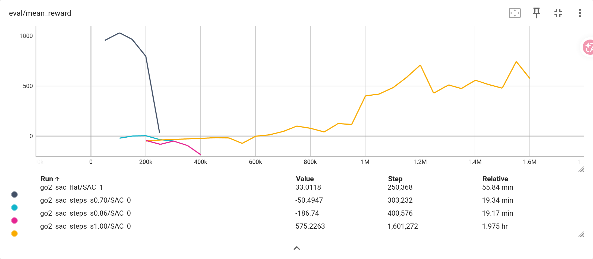

# 10.10
## 18：00
下午将replay buffer续训不继承的问题解决了，并通过不换阶段续训证明replay buffer确实对续训会产生极大影响。但加step后效果仍不理想，出现右前脚几乎不动被拖着走的情况，在解决replay buffer问题之前，也出现过各种跑资，如用膝盖跑，这些跑法都不利于上台阶。现怀疑是平地跑阶段学习不足的问题，现换阶段时用原来的best model，但多次训练平地阶段的best model都是出现在50000步时，更多训练反而效果更差，应该是因为前5w步主要受预热有较标准的跑姿，但应对随机初始化能力不足，在用该checkpoint进入下一阶段时同时增加了训练次数（即随机到不好开局的次数）和复杂地形，会迅速退化，出现奇怪跑姿，现拉长平地训练时长，先经历大量随机开局再进入下一阶段，确认是否是该问题。
## 19：04
现在训练800k步，play展现出两种极端情况，要么正常一路小跑，要么拖着一条腿慢慢蹦跶很容易偏航，出现拖着一条腿的情况下往往后腿的脚球往往较靠后，怀疑与关节位置初始化有关，但reset只初始化了qpos[0:7]，指向机器人位姿，难道关节还沿用上回合结束时的角度？
## 19：44
mj_resetDataKeyframe会将关节重置，单腿拖地是由速度导致的，学习到的速度策略不足以覆盖所有随机范围。更重要的是观测量问题，缺少直接的yaw，先补上，之后如果实在不行再加上高层观测量——绝对坐标。

# 10.11
## 9:43
跑了一晚上，第二天醒来发现硬盘炸了，只训到step1.00，但好消息是训练效果确实不错，step1.00课程训了近800k，我怀疑逐渐增高台阶的课程用处可能不大，基本相当于从头训了，直接增大训练步数效果也不差。  
此外，保存replay buffer的文件一个就100+MB，所以昨天硬盘炸了，今天得将保存的checkpoint间隔增大，不然又炸了。今天继续训楼梯课程。

# 10.12
## 14:15
full阶段长训练后发生退化，从最开始能爬两级台阶到爬不了一个。先修复超时处理消失、台阶反复上下刷分的问题。我认为在step和full阶段之间应该再加一个action_scale=0.7的step1.00的课程作为过渡。但感觉并无法解决退化的问题。  
观察step的的训练曲线，我认为逐渐提高台阶高度的课程意义不大。

## 21:37
将爬楼梯相关奖励提高，将出生点放在楼梯前（可以将楼梯相关奖励占最后总奖励占比提高），以较低楼梯高度课程开始训练，可以较快实现有概率登顶。  
上面提出的“在step和full阶段之间应该再加一个action_scale=0.7的step1.00的课程作为过渡”是有效的。  
在step阶段可以没有梯度课程，但楼梯阶段确实需要，低高度可以让模型一开始就能爬上去，知道爬上去的奖励更大，低高度训练的模型甚至在无更高高度训练的情况下爬上去，如果训练时发现一直无效果，可以降低难度训练，有助于走出局部最优解。  
爬楼梯阶段维持步数长不代表效果好，大概率是模型选择卡在某个地方到回合结束，这可以作为一个落入局部最优解的证据。

# 10.13
## 21：51
将step提高至2.0,其高度与一级台阶相当，经过稍微训练即可通过，达到与step1.0相近的效果，但楼梯还是不行。  
full的低高度训练仍有必要，full0.4可以在无训练情况下有概率登顶，在训练后甚至可以用full0.4的模型登顶更高的高度，比直接在该高度训练效果更好。full0.4的一级stair高度为0.06,低于step1.00的高度，或许更高的step可以使其适应楼梯？  
我想应该把step与stair的scale解耦，可以分别调节，否则即使有新增的参数--reset-frac-stair训练时有概率刷新在原点，一直走低的槛仍可能退化不会过更高的槛。  
后续可以尝试增加不前进的惩罚。观测量就不再动了。

## 22:14
重新审查step2.00,其通过效果并不好，还需要继续训练，测试相同高度的step是否能使其适应stair。经尝试，step1.5反而比step2.0可以在未训练情况下上更多级stair，应该是2.0训练不足，但仍会退化。

# 10.14
## 11:59
step2.0持续训练发生退化,先尝试训一个step1.8的。